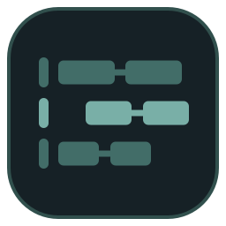
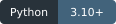

# ComfyShelf

    

Test badges show a [dated local test snapshot](docs/test-status.md), not a live GitHub build.

**More room for creating. Less time juggling gigabytes.**

ComfyUI workflows and modern generative models (SDXL, Flux, Pony, SD1.5, etc.) quickly consume hundreds of gigabytes on fast SSDs. ComfyShelf is a lightweight, visual shelf and disk space manager designed specifically for ComfyUI.

Park unused workflows on secondary storage, free up SSD space with confidence, and bring full setups back with a single click.

[User guide (English)](docs/guide.en.md) · [Deutsche Anleitung](docs/guide.de.md)

---

## Core Features

- **Instant Loading via Symlinks & Hardlinks (No Duplicate Disk Space)**  
  Restoring a 50 GB workflow back into ComfyUI shouldn't keep you waiting for huge files to copy. With **Instant Link** mode, ComfyShelf uses NTFS Hardlinks (on the same drive) or Windows Symlinks to make models available in ComfyUI in milliseconds — consuming 0 additional bytes of disk space. Visual status badges (`🔗 Hardlink`, `⚡ Symlink`) show the link type in the detail view, with automatic fallback to physical copies if needed. Keep as many massive workflows ready to roll as you want without filling your drive (though your GPU can still only melt through one generation at a time!).

- **Deduplicated Shared Model Storage**  
  When multiple workflows rely on the same 12 GB checkpoint, LoRA, or VAE, ComfyShelf stores that file **only once** in a shared model archive. Individual workflow packages remain lightweight (just the node graph, metadata, and cover thumbnail), preventing your backup drive from filling up with redundant duplicates.

- **Safe Unloading with SHA-256 Checksums**  
  Freeing up space by unloading a workflow removes local model copies from ComfyUI — but **only after** an automated SHA-256 checksum comparison confirms that an identical, uncorrupted copy is safely preserved in your archive. If a file is damaged, incomplete, or modified, ComfyShelf never touches the original. A verification cache keeps subsequent checks fast without re-reading gigabytes from disk.

- **Shared Model Collision Protection**  
  No broken workflows: before unloading or removing files, ComfyShelf checks whether other active workflows depend on those same models. Shared files are protected so you don't accidentally break another project.

- **Visual Workflow Shelf with PNG Metadata Extraction**  
  Drag & drop a generated `.png` image directly onto ComfyShelf. It automatically extracts the embedded ComfyUI workflow graph, detects all required models, and uses the image as a high-res cover thumbnail with a built-in zoom lightbox. Standard `.json` workflow files and `.zip` archives work just as well.

- **Real-Time Search & Scope Filtering (`Ctrl + F`)**  
  Find any workflow in your library quickly. Filter across custom scopes (`[All]`, `[Name]`, `[Model]`, `[Node]`). Match badges highlight exact hits directly in the workflow list (e.g. `🔍 Model: qwen_image_edit_fp8.safetensors`), so you immediately see why a workflow matched without digging through complex node graphs.

- **Custom Node Live Diagnostics & 1-Click Search**  
  Inspects all custom nodes used in a workflow against your active ComfyUI installation (Installed vs. Missing). Provides direct links to original GitHub repositories and 1-click clipboard copy to locate and install missing nodes quickly via ComfyUI-Manager.

- **Hugging Face Model Resolver & Downloader (Trust & Transparency First)**
  Missing a checkpoint, LoRA, VAE, or text encoder? Don't blindly download unknown files. ComfyShelf offers direct 1-click access to the official Hugging Face Model Card or search mask directly in your browser. Download missing models directly into ComfyUI or your shared pool with live background streaming (speed in MB/s, ETA, percentage), on-the-fly SHA-256 integrity verification, and instant status updates from *Missing* to *Ready*.

- **Smart Template & Dummy Model Filter**
  Template workflows shared online frequently contain placeholder model names (`YOUR_LORA_2_DISABLED.safetensors`, `PUT_YOUR_LORA_HERE`, `PLACEHOLDER`, `[none]`, etc.). ComfyShelf recognizes and excludes these dummy entries automatically, ensuring your template workflows stay valid and green without falsely warning about missing files.

- **Self-Healing Archives & Portable Export**  
  Archived a workflow while a model was still downloading? The **Rescan Incomplete Workflow** feature scans for newly acquired files, verifies their hashes, creates a timestamped backup of the archive, and completes the package. Need to take a workflow to another PC or share it with a friend? **Export Portable ZIP** bundles the workflow and its required models into a self-contained, standalone package.

- **Safe & Non-Destructive by Design**  
  Supports the Windows Recycle Bin for safe deletion. ComfyShelf never alters ComfyUI's core code, settings, or Python environment. Runs 100% locally with zero telemetry, full offline capability, and a clean bilingual interface (English and German).

---

## How It Works in 3 Simple Steps

1. **Archive:** Select or drag & drop a `.png` or `.json` workflow. ComfyShelf analyzes the graph, lists all required models, and copies them to your archive storage. Your local ComfyUI files remain completely untouched.
2. **Unload:** When you need disk space on your fast drive, click **Unload workflow**. ComfyShelf verifies SHA-256 hashes against the archive and safely removes local copies (or moves them to the Recycle Bin).
3. **Load:** Ready to generate again? Click **Load workflow**. With Instant Link mode, multi-gigabyte models are linked back into ComfyUI in milliseconds without consuming duplicate disk space or waiting for lengthy file transfers.

---

## Get started on Windows

**This is an early version. There is no ready-to-run EXE yet.** Setup and native window startup still need testing on a clean Windows computer.

You need an existing ComfyUI installation, installed **64-bit Python 3.10 or newer**, internet access for the initial setup, and enough storage space for your archived files.

1. Save the **whole ComfyShelf folder** in a writable location (e.g. Documents). If you received a ZIP, extract it first; do not run setup from inside the ZIP.
2. Double-click **Setup_ComfyShelf.cmd**. Choose English or German and confirm the installation. It prepares an isolated Python environment for the app without altering ComfyUI or your models.
3. When setup finishes, double-click **Start_ComfyShelf.cmd** (or the **ComfyShelf** desktop shortcut).
4. Select your ComfyUI directory and a separate archive directory (preferably on a secondary drive with ample free space). You can configure your preferred **Model Loading Method** (Instant Link via Hardlink/Symlink or Full Copy) in the settings dialog.

You do not need to type commands or edit configuration files. If Python is missing, setup guides you on how to install it.

For the complete first-run walkthrough and troubleshooting:
- [English instructions](docs/guide.en.md)
- [Deutsche Anleitung](docs/guide.de.md)

---

## Important before you start

- **Unloading deletes verified local model copies from ComfyUI.** Their archived copies remain safe in the shared pool. Always finish running generations before unloading, and review the confirmation preview.
- **Detection is not perfect.** Unusual custom loaders or dynamically generated filenames might not be detected automatically. Review warnings and keep a separate backup of anything irreplaceable.
- **A successful file check does not guarantee a complete generation.** Custom nodes, compatible software versions, and sufficient GPU hardware still matter.
- **Standard workflow ZIPs in the archive rely on the shared model folder.** Use **Export portable ZIP…** if you want a standalone archive to transfer to another machine. Keep the entire archive directory together when backing up your collection.

Both user guides explain these details and everyday operations in depth:
- [User guide (English)](docs/guide.en.md)
- [Deutsche Anleitung](docs/guide.de.md)

---

## For advanced users and contributors

Normal use does not require the command line. Additional documentation:

- [English CLI reference](docs/reference.en.md#command-line-reference)
- [Technische Referenz (Deutsch)](docs/reference.de.md)
- [Safety and limitations](docs/safety.md)
- [Development and tests](CONTRIBUTING.md)
- [Release checklist](docs/release-checklist.md)

---

## Support

If ComfyShelf saves you disk space or makes managing your workflows easier, consider supporting the project:

---

## License

ComfyShelf's original code and documentation are licensed under the [GNU Affero General Public License v3.0 only](LICENSE) (`AGPL-3.0-only`). Third-party components retain their own licenses. This license does not change the rights or licenses of the models and workflows you archive.
