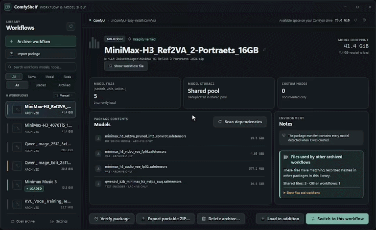

# ComfyShelf

    

Test badges show a [dated local test snapshot](docs/test-status.md), not a live GitHub build.

**More room for creating. Less time juggling gigabytes.**

ComfyUI workflows and modern generative models (SDXL, Flux, Pony, SD1.5, etc.) quickly consume hundreds of gigabytes on fast SSDs. ComfyShelf is a lightweight, visual shelf and disk space manager designed specifically for ComfyUI.

Park unused workflows on secondary storage, free up SSD space with confidence, and bring full setups back with a single click.

[User guide (English)](docs/guide.en.md) · [Deutsche Anleitung](docs/guide.de.md)

  

---

## Core Features

- **Zero Red Outlines in ComfyUI (All Dependencies Linked in Place)**  
  No missing-model crashes or red-boxed node graphs when opening a workflow. ComfyShelf verifies that every checkpoint, LoRA, VAE, and text encoder is linked exactly where ComfyUI expects it before you hit generate.

- **Instant Loading via Symlinks & Hardlinks (No File Copy Delay)**  
  Restoring a 50 GB workflow back into ComfyUI shouldn't keep you waiting for huge files to copy. With **Instant Link** mode, ComfyShelf uses NTFS Hardlinks (on the same drive) or Windows Symlinks to make models available in ComfyUI in milliseconds — consuming 0 additional bytes of disk space. Prefer traditional standalone files instead of links? You can easily switch the loading method to full physical copying at any time in the settings. Visual status badges (`⚡ Hardlink`, `🔗 Symlink`, `📁 Copy`) show the active loading method in the detail view, with automatic fallback to physical copies if needed.

- **Instant Canvas Paste (`Ctrl + V` Workflow Clipboard)**  
  Zero tab clutter and zero reload delays. ComfyShelf copies the entire workflow node tree directly into your clipboard — either automatically when loading a workflow or via 1-click `[Copy workflow · Ctrl+V]`. Switch to your open ComfyUI browser tab, press `Ctrl + V`, and the complete node graph drops right onto your canvas ready to generate.

- **Keep Multiple Massive Workflows Active at Once (0 Extra SSD Space)**  
  You don't have to choose just one active project. Use **Load in addition** to keep 3, 5, or 10 heavy workflows (Flux, SDXL, Video pipelines) active simultaneously in your ComfyUI tabs. Switch between setups with zero wait time and zero duplicate disk consumption.

- **Deduplicated Shared Model Pool (Store Every File Only Once)**  
  All your models live in a single, deduplicated archive on your secondary drive. When multiple workflows rely on the same 12 GB checkpoint, LoRA, or VAE, ComfyShelf stores that file **only once**. Individual workflow packages remain lightweight (just the node graph, metadata, and cover thumbnail), preventing your backup drive from filling up with redundant duplicates.

- **Visual Model Pool & Deduplication Overview**  
  Want to know exactly how much disk space ComfyShelf is saving? The dedicated **Model Pool** dashboard breaks down all stored models by category (Checkpoints, LoRAs, VAEs, Diffusion Models, etc.), calculates total deduplication savings, lists active models in ComfyUI, and shows which workflows share each file.

- **Safe Unloading with SHA-256 Checksums (Anxiety-Free SSD Cleanup)**  
  Freeing up space by unloading a workflow removes local model copies from ComfyUI — but **only after** an automated SHA-256 checksum comparison confirms that an identical, uncorrupted copy is safely preserved in your archive. If a file is damaged, incomplete, or modified, ComfyShelf never touches the original. A verification cache keeps subsequent checks fast without re-reading gigabytes from disk.

- **Shared Model Collision Protection (Never Breaks Other Active Projects)**  
  No broken workflows: before unloading or removing files, ComfyShelf checks whether other active workflows depend on those same models. Shared files are protected automatically so you don't accidentally break another project.

- **Smooth Drag & Drop Workflow Sorting & Quick Reordering**  
  Keep your most important setups right at hand. Freely arrange workflows in the sidebar via smooth drag & drop reordering with dedicated grip handles, or switch sorting modes on the fly (**Manual / Drag & Drop**, **Recently modified**, or **Name A–Z**). Your custom order is saved automatically.

- **Visual Workflow Shelf with PNG Metadata Extraction**  
  Drag & drop a generated `.png` image directly onto ComfyShelf. It automatically extracts the embedded ComfyUI workflow graph, detects all required models, and uses the image as a high-res cover thumbnail with a built-in zoom lightbox. Standard `.json` workflow files and `.zip` archives work just as well.

- **Hugging Face & Civitai Model Resolution & Downloader (1-Click Lookup)**  
  Missing a checkpoint, LoRA, VAE, or text encoder? Don't blindly search for unknown files. ComfyShelf offers direct 1-click access to the official Hugging Face Model Card or Civitai search mask directly in your browser. Download missing models directly from Hugging Face into ComfyUI or your shared pool with live background streaming (speed in MB/s, ETA, percentage), on-the-fly SHA-256 integrity verification, and instant status updates from *Missing* to *Ready*.

- **Custom Node Live Diagnostics & 1-Click Search**  
  Inspects all custom nodes used in a workflow against your active ComfyUI installation (Installed vs. Missing). Provides direct links to original GitHub repositories and 1-click clipboard copy to locate and install missing nodes quickly via ComfyUI-Manager.

- **Smart Template & Dummy Model Filter (No False Alarms)**  
  Template workflows shared online frequently contain placeholder model names (`YOUR_LORA_2_DISABLED.safetensors`, `PUT_YOUR_LORA_HERE`, `PLACEHOLDER`, `[none]`, etc.). ComfyShelf recognizes and excludes these dummy entries automatically, ensuring your template workflows stay valid and green without falsely warning about missing files.

- **Self-Healing Archives & 1-Click Portable ZIP Export**  
  Archived a workflow while a model was still downloading? The **Rescan Incomplete Workflow** feature scans for newly acquired files, verifies their hashes, creates a timestamped backup of the archive, and completes the package. Need to take a workflow to another PC or share it with a friend? **Export Portable ZIP** bundles the workflow and its required models into a self-contained, standalone package.

- **Real-Time Search & Scope Filtering (`Ctrl + F`)**  
  Find any workflow in your library quickly. Filter across custom scopes (`[All]`, `[Name]`, `[Model]`, `[Node]`). Match badges highlight exact hits directly in the workflow list (e.g. `🔍 Model: qwen_image_edit_fp8.safetensors`), so you immediately see why a workflow matched without digging through complex node graphs.

- **100% Local, Offline & Safe by Design**  
  Supports the Windows Recycle Bin for safe deletion. ComfyShelf never alters ComfyUI's core code, settings, or Python environment. Runs 100% locally with zero telemetry, full offline capability, and a clean bilingual interface (English and German).

---

## How It Works in 3 Simple Steps

1. **Archive:** Select or drag & drop a `.png` or `.json` workflow. ComfyShelf analyzes the graph, lists all required models, and copies them to your archive storage. Your local ComfyUI files remain completely untouched.
2. **Unload:** When you need disk space on your fast drive, click **Unload workflow**. ComfyShelf verifies SHA-256 hashes against the archive and safely removes local copies (or moves them to the Recycle Bin).
3. **Load:** Ready to generate again? Click **Load workflow**. With Instant Link mode, multi-gigabyte models are linked back into ComfyUI in milliseconds without consuming duplicate disk space or waiting for lengthy file transfers.

---

## Get started on Windows

**ComfyShelf v1.0.0** is available in three convenient ways:

### Option 1: Windows Setup Installer (`.exe`) — *Recommended*
1. Download **`ComfyShelf-v1.0.0-windows-setup.exe`** from the [Releases](https://github.com/Reaaaaa/ComfyShelf/releases) page.
2. Run the installer. It installs per-user into `%LOCALAPPDATA%\Programs\ComfyShelf` — **no administrator privileges required**, no system modifications.
3. Launch ComfyShelf directly from your Start Menu or Desktop shortcut.

### Option 2: Portable Version (`.zip`)
1. Download **`ComfyShelf-v1.0.0-windows-portable.zip`**.
2. Extract the folder anywhere you like (e.g. on your desktop, secondary drive, or USB drive).
3. Double-click **`ComfyShelf.exe`** to run immediately — no installation, no extra runtime setup.

### Option 3: Run from Source / Batch Script
1. Clone the repository or download the source folder.
2. Double-click **`Setup_ComfyShelf.cmd`** (requires Python 3.10+ installed).
3. Once the environment is prepared, start the app via **`Start_ComfyShelf.cmd`**.

> [!NOTE]
> **Windows SmartScreen Notice:**  
> Because ComfyShelf is an open-source project and unsigned binaries do not purchase expensive commercial code-signing certificates, Windows SmartScreen may show an informational prompt (*"Windows protected your PC"*). Click **"More info"** (*"Weitere Informationen"*) and then **"Run anyway"** (*"Trotzdem ausführen"*). All code and build pipelines are 100% open-source and auditable.

### First-Time Configuration
1. When starting ComfyShelf for the first time, select your **ComfyUI directory** (standard git, official portable standalone, or one-click setups like **[ComfyUI-Easy-Install](https://github.com/Tavris1/ComfyUI-Easy-Install)**).
2. Choose a separate **archive directory** (preferably on a secondary drive with ample storage space).
3. In the settings dialog, choose your preferred **Model Loading Method** (Instant Link via Hardlink/Symlink or Full Copy).

For the complete first-run walkthrough and troubleshooting:
- [English instructions](docs/guide.en.md)
- [Deutsche Anleitung](docs/guide.de.md)

---

## Important before you start

- **Unloading deletes verified local model copies from ComfyUI.** Their archived copies remain safe in the shared pool. Always finish running generations before unloading, and review the confirmation preview.
- **Detection is not perfect.** Unusual custom loaders or dynamically generated filenames might not be detected automatically. Review warnings and keep a separate backup of anything irreplaceable.
- **A successful file check does not guarantee a complete generation.** Custom nodes, compatible software versions, and sufficient GPU hardware still matter.
- **Standard workflow ZIPs in the archive rely on the shared model folder.** Use **Export portable ZIP…** if you want a standalone archive to transfer to another machine. Keep the entire archive directory together when backing up your collection.

Both user guides explain these details and everyday operations in depth:
- [User guide (English)](docs/guide.en.md)
- [Deutsche Anleitung](docs/guide.de.md)

---

## For advanced users and contributors

Normal use does not require the command line. Additional documentation:

- [English CLI reference](docs/reference.en.md#command-line-reference)
- [Technische Referenz (Deutsch)](docs/reference.de.md)
- [Safety and limitations](docs/safety.md)
- [Development and tests](CONTRIBUTING.md)
- [Release checklist](docs/release-checklist.md)

---

## Support

If ComfyShelf saves you disk space or makes managing your workflows easier, consider supporting the project:

---

## License

ComfyShelf's original code and documentation are licensed under the [GNU Affero General Public License v3.0 only](LICENSE) (`AGPL-3.0-only`). Third-party components retain their own licenses. This license does not change the rights or licenses of the models and workflows you archive.
