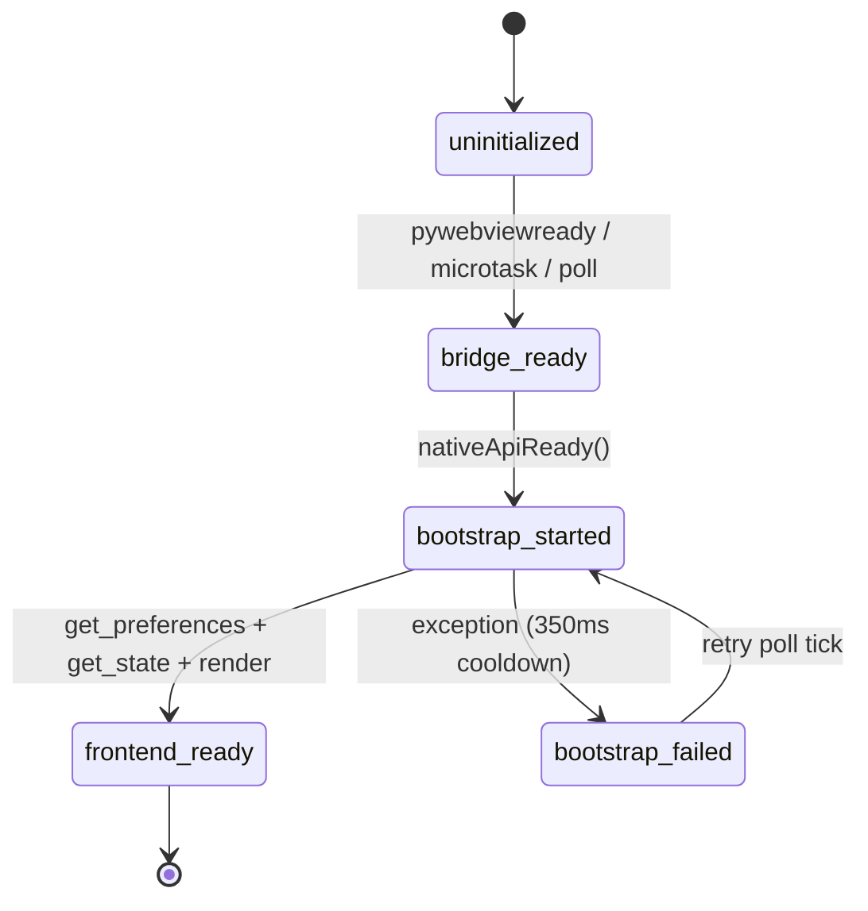
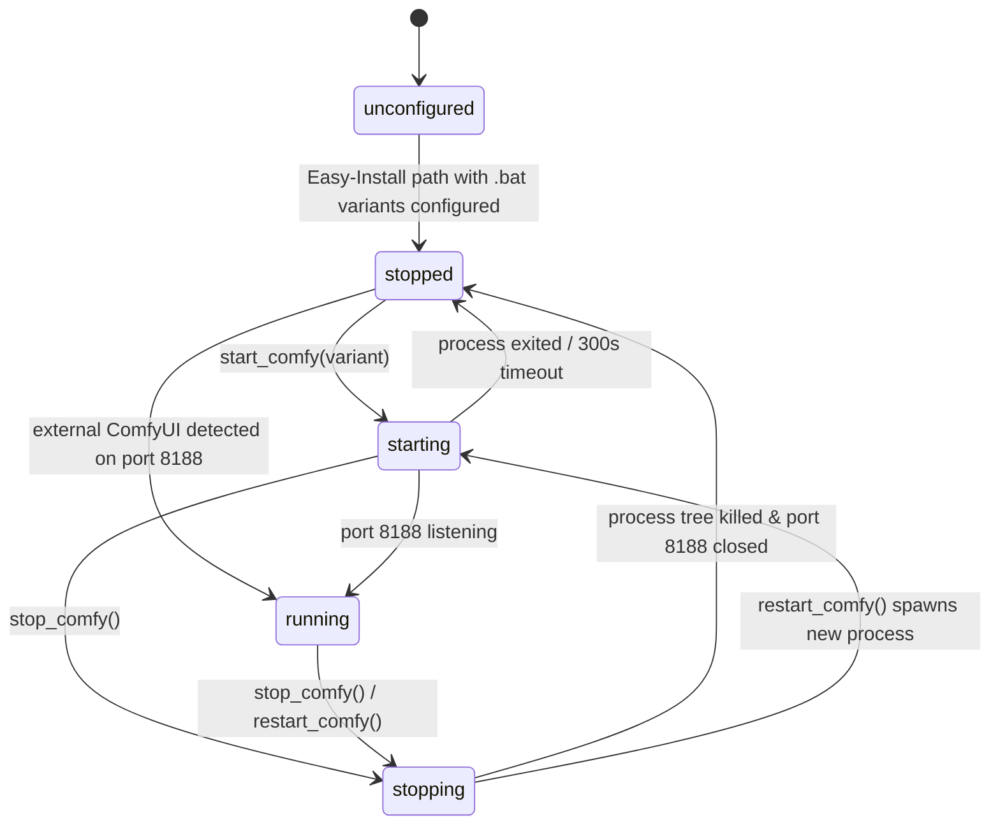
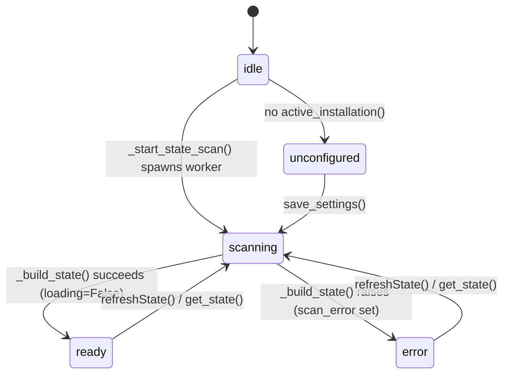
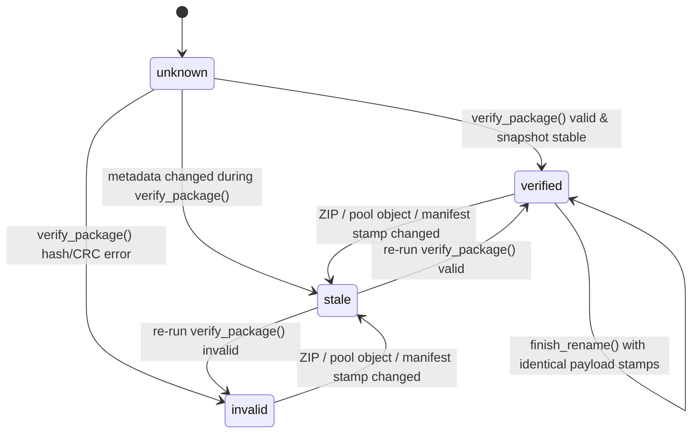
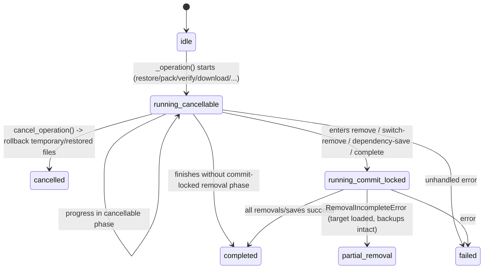

# ComfyShelf State Machine Architecture & Specification

Across the Python backend ([`workflow_switcher_gui.py`](../workflow_switcher_gui.py), [`comfy_archive.py`](../comfy_archive.py), [`verification_cache.py`](../verification_cache.py), [`dependency_scan.py`](../dependency_scan.py), [`workflow_file.py`](../workflow_file.py), [`model_downloader.py`](../model_downloader.py)) and the JavaScript frontend ([`gui/app.js`](../gui/app.js)), ComfyShelf is governed by **12 distinct, explicit state machines**.

These state machines are centralized in a zero-dependency specification and runtime transition layer in [`state_machines.py`](../state_machines.py) and [`gui/app.js`](../gui/app.js), providing mathematical guarantees against deadlocks, race conditions, UI flicker, and orphaned modal states.

---

## Architecture Summary: UX, DX, and AX Elevations

> [!IMPORTANT]
> Every state enum in [`state_machines.py`](../state_machines.py) inherits from `(str, Enum)` so existing JSON payloads and string comparisons remain 100% wire-compatible, and all state tracking fields on `WorkflowSwitcherApi` remain private (`_...`) so `pywebview` bridge reflection never traverses non-callable attributes.

| Dimension | What Was Implicit / Fragile | How It Was Elevated |
| :--- | :--- | :--- |
| **UX (User Experience)** | **1. Launcher `"stopping"` poll race**: While `stop_comfy()` or `restart_comfy()` was terminating the process tree (taking up to 3–4s), background `get_comfy_status()` polls saw port `8188` still open and flashed the UI status pill from *Stopping…* back to *Running*, and clicking the pill during `starting`/`stopping` could trigger a duplicate start. **2. Fragmented Modal `Escape` & Sub-dialog Orphan Bug**: Pressing `Escape` while a Model Pool sub-dialog (`#loadPoolModelModal` or `#unloadPoolModelModal`) was open closed the parent `#modelPoolModal` underneath it while leaving the sub-dialog orphaned on screen. | **1. Deterministic `LauncherState`**: Backend tracks `_comfy_stopping` across stop and restart transitions; `get_comfy_status()` reports `stopping: True, running: False, state: "stopping"`, and `onComfyStatusPillClick()` ignores clicks while in `starting` or `stopping`. **2. Z-Ordered Modal Stack Controller (`closeTopActiveOverlay()`)**: Pressing `Escape` is blocked while `#busyOverlay` is active and otherwise closes **only the topmost open layer** across all 12 overlays/modals/dropdowns. |
| **DX (Developer Experience)** | State transitions and Action Dock button permutations were scattered across nested `if/else` chains in Python and JS; downloading a model into a package via `_integrate_downloaded_model()` did not update `manifest["storage_mode"]` consistently with `complete_dependencies()`. | Centralized transition rules in [`state_machines.py`](../state_machines.py) (`derive_package_load_state`, `resolve_package_actions`, `derive_package_storage_mode`, `is_phase_cancellable`) and declarative `PACKAGE_ACTION_SPECS` in `gui/app.js`. |
| **AX (Agent Experience)** | AI agents and automated test harnesses had to read thousands of lines across 7 files to infer valid states, invariants, and live subsystem status. | Added `WorkflowSwitcherApi.get_state_machines()`, `get_state_machine_catalog()`, and frontend `getFrontendStateSnapshot()` so any agent or test can inspect all 12 state machine schemas and real-time states in one call. |

---

## Catalog of All 12 State Machines in ComfyShelf

### 1. Native Bridge & Frontend Bootstrap Lifecycle (`bootstrap`)
- **Locations**: [`workflow_switcher_gui.py`](../workflow_switcher_gui.py), [`gui/app.js`](../gui/app.js), [`BootstrapStage` in `state_machines.py`](../state_machines.py)
- **Invariants**:
  - Uses three independent entry triggers (`pywebviewready` event, `queueMicrotask` immediate check, and 50ms polling up to 240 attempts / 12s).
  - If `bootstrap()` throws, `bootstrapStarted` resets with a 350ms cooldown (`bootstrapRetryAfter`) so subsequent poll ticks can recover.
  - Once `frontend-ready` is reached, `_frontend_ready` (`threading.Event`) is permanently set and `next_bootstrap_stage` never regresses.

---

### 2. ComfyUI Process & Port 8188 Lifecycle (`launcher`)
- **Locations**: [`workflow_switcher_gui.py`](../workflow_switcher_gui.py), [`gui/app.js`](../gui/app.js), [`LauncherState` in `state_machines.py`](../state_machines.py)
- **Invariants**:
  - `stopping` takes precedence over port `8188` probes so UI status polling never flickers back to `running` while `taskkill` or `WM_CLOSE` is tearing down the process tree.
  - `starting` remains active while the spawned `Popen` process is alive (or up to 300s) until port `8188` begins listening.

---

### 3. Asynchronous Library Scan & State Cache Lifecycle (`library_scan`)
- **Locations**: [`workflow_switcher_gui.py`](../workflow_switcher_gui.py), [`gui/app.js`](../gui/app.js), [`LibraryScanState` in `state_machines.py`](../state_machines.py), [`ScanProgressStage` in `state_machines.py`](../state_machines.py)
- **Invariants**:
  - Guarded by `_state_lock` so at most one `library-scan` thread runs at any time.
  - While `scanning`, `_loading_state` serves the previous `_state_cache` with `loading: True` for instant non-blocking UI rendering, then pushes `window.workflowStateUpdated(state)` when finished.
  - Sub-stages advance monotonically: `configuration` → `drives` → `archive` → `package`.

---

### 4. Workflow Package Deployment, Visibility & Action Matrix (`package_load`)
- **Locations**: [`workflow_switcher_gui.py`](../workflow_switcher_gui.py), [`gui/app.js`](../gui/app.js), [`PackageLoadState` in `state_machines.py`](../state_machines.py)
- **Invariants**:
  - `loaded`: `model_count == 0` or `present_models == model_count`
  - `archived`: `model_count > 0` and `present_models == 0`
  - `partial`: `0 < present_models < model_count`
  - Orthogonal `hidden` flag is only valid when `state == "archived"`; restoring or switching to a workflow automatically clears its hidden status, and attempting to hide a `loaded` or `partial` workflow is rejected.

| `pkg.state` | `otherActive` | Primary Button | Secondary Button | Tertiary Button |
| :--- | :--- | :--- | :--- | :--- |
| **`loaded`** | `false` / `true` | `unload` (*Unload*) | — | — |
| **`archived`** | `false` | `load` (*Load into ComfyUI*) | — | — |
| **`archived`** | `true` | `switch` (*Switch to Workflow*) | `load_additional` (*Load Additionally*) | — |
| **`partial`** | `false` | `load_missing` (*Load Missing Models*) | `unload_present` (*Unload Present Models*) | — |
| **`partial`** | `true` | `switch` (*Switch to Workflow*) | `load_missing` (*Load Missing Models*) | `unload_present` (*Unload Present Models*) |

---

### 5. Package Storage Layout & Deduplication Lifecycle (`package_storage`)
- **Locations**: [`comfy_archive.py`](../comfy_archive.py), [`dependency_scan.py`](../dependency_scan.py), [`model_downloader.py`](../model_downloader.py), [`PackageStorageMode` in `state_machines.py`](../state_machines.py)
- **Invariants**:
  - `embedded-portable`: All model payloads reside inside the `.zip` archive.
  - `mixed`: Some models reside in `.comfyshelf/objects/sha256/...` (or local), others inside the `.zip`.
  - `shared-object-pool`: All model entries have `storage == "shared-object"`.
  - Before unloading or switching any package with non-pooled models, `pool-prepare` runs `deduplicate_package` so no model is ever deleted from ComfyUI without a verified backup in the shared pool.

---

### 6. Verification Cache Integrity State Machine (`verification_cache`)
- **Locations**: [`verification_cache.py`](../verification_cache.py), [`comfy_archive.py`](../comfy_archive.py), [`VerificationState` in `state_machines.py`](../state_machines.py)
- **Invariants**:
  - Snapshots bind `(zip stat stamp, referenced shared object stat stamps, manifest SHA-256)`.
  - Any modification to the ZIP, manifest, or shared pool objects automatically transitions `verified` or `invalid` to `stale`.
  - If an archive is modified *while* `verify_package` is streaming, the post-read snapshot check invalidates `checked_snapshot` so `remember()` records `stale`.
  - `prepare_rename` / `finish_rename` carries `verified` across archive renames only if the payload snapshot is unchanged.

---

### 7. Cancellable Operation & Point-of-No-Return Lifecycle (`operation_lifecycle`)
- **Locations**: [`workflow_switcher_gui.py`](../workflow_switcher_gui.py), [`comfy_archive.py`](../comfy_archive.py), [`OperationLifecycleState` in `state_machines.py`](../state_machines.py)
- **Invariants**:
  - Preparatory and additive phases (`preparing`, `scan`, `dependency-scan`, `verify`, `local-hash`, `references`, `pool-prepare`, `deduplicate`, `pack`, `import`, `download`, `deploy-copy`, `restore`) are **cancellable** and roll back all temporary/restored files on `OperationCancelled`.
  - Destructive/commit phases (`remove`, `switch-remove`, `dependency-save`, `complete`) set `cancellable=False` (**point of no return**), disabling `#cancelOperationButton` in the UI and ignoring `_cancel_event`.
  - In `switch_package`, target workflow models are restored *before* previous workflow models are removed; if an OS lock halts removal mid-way (`RemovalIncompleteError` -> `partial_removal`), the target workflow remains runnable and all remaining files stay backed up in the pool.

---

### 8. Two-Phase Token-Guarded Preview & Commit Lifecycle (`transactional_token`)
- **Locations**: [`dependency_scan.py`](../dependency_scan.py), [`workflow_file.py`](../workflow_file.py), [`TransactionalTokenState` in `state_machines.py`](../state_machines.py)
- **Invariants**:
  - Phase 1 (`previewed`) computes a cryptographic SHA-256 `token` over the archive, target, and candidate file stamps `(exists, size, mtime_ns)`.
  - Phase 2 (`confirmed`) re-scans and recomputes the token; if any file drifted while the user was reading the confirmation dialog, the commit aborts with `dependency_stale` or `workflow_changed` (`stale_aborted`) before mutating disk state.

---

### 9. Workflow Graph Asset Detection & Resolution Pipeline (`asset_resolution`)
- **Locations**: [`comfy_archive.py`](../comfy_archive.py), [`state_machines.py`](../state_machines.py)
- **Invariants**:
  - Detection cascades through `custom-node-rule` → `known-node-rule` → `named-input-rule` → `extension-heuristic` → `unresolved-loader`.
  - Resolution classifies each candidate into `exact-path`, `relative-suffix`, `basename-fallback`, `ambiguous-path`, `path-mismatch`, `unsafe-path`, or `not-found`.

---

### 10. Frontend Main Content View State Machine (`ui_main_view`)
- **Locations**: [`gui/app.js`](../gui/app.js)
- **States**: `unconfigured` → `loading` (with 4s transition to slow-loading note) → `empty_library` | `detail`.
- **Invariants**:
  - Exactly one of `#emptyState`, `#loadingState`, or `#detailView` is visible at any given time.

---

### 11. Frontend Modal, Subdialog & Overlay Z-Stack State Machine (`ui_modal_stack`)
- **Locations**: [`gui/app.js`](../gui/app.js)
- **Z-Priority Order (Topmost First)**:
  1. `busyOverlay` *(blocking guard: prevents `Escape` from dismissing underlying modals during an active operation)*
  2. `lightboxModal`
  3. `tourModal`
  4. `loadPoolModelModal` *(sub-dialog over `modelPoolModal`)*
  5. `unloadPoolModelModal` *(sub-dialog over `modelPoolModal`)*
  6. `downloadModal`
  7. `deleteModal`
  8. `renameModal`
  9. `confirmModal`
  10. `historyModal`
  11. `modelPoolModal`
  12. `settingsModal` *(closable only when `app.state.configured` is true and `#settingsCloseButton` is not hidden)*
  13. `workflowSortDropdown`
- **Invariants**:
  - Sub-dialogs sit directly above `modelPoolModal`; pressing `Escape` dismisses the sub-dialog while preserving `modelPoolModal`.

---

### 12. Dual-Mode Drag & Drop Interaction State Machine (`ui_drag_drop`)
- **Locations**: [`gui/app.js`](../gui/app.js)
- **Invariants**:
  - Internal card drag (`app.isDraggingWorkflow = true`) suppresses the external OS file `#dropOverlay` (`external_file_hover`).
  - Completing an internal card drop while in `recent` or `name` sort mode automatically transitions `app.sortMode` to `manual`, persists the custom order, and notifies the user via toast.
